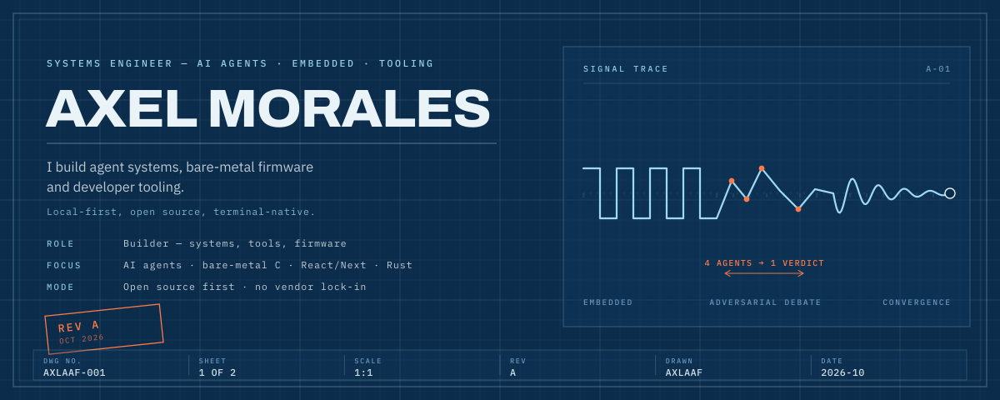
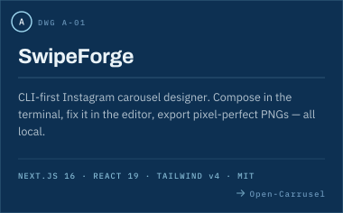
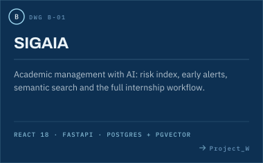
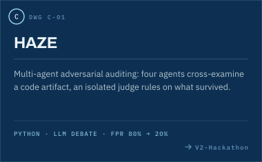
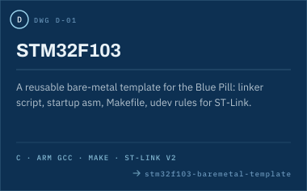
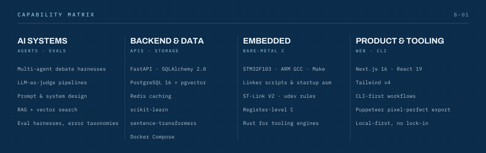
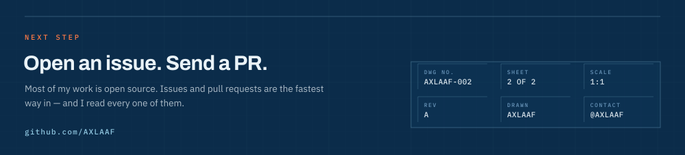

  
  
  

<table>
  <tr>
    <td width="50%"></td>
    <td width="50%"></td>
  </tr>
  <tr>
    <td width="50%"></td>
    <td width="50%"></td>
  </tr>
</table>

| Repository | What it is | Stack |
| --- | --- | --- |
| [Hakaton](https://github.com/AXLAAF/Hakaton) | Global South AI Safety Hackathon — starter template, eval harness, submission write-up | Python |
| [Construccion-de-Sofrware](https://github.com/AXLAAF/Construccion-de-Sofrware) | Software construction coursework — JUnit suites and performance tests | Java |
| [SAQ_Marcos_XOOKTECH](https://github.com/AXLAAF/SAQ_Marcos_XOOKTECH) | Software analysis & quality project with the XOOKTECH team | Java |

  
  

